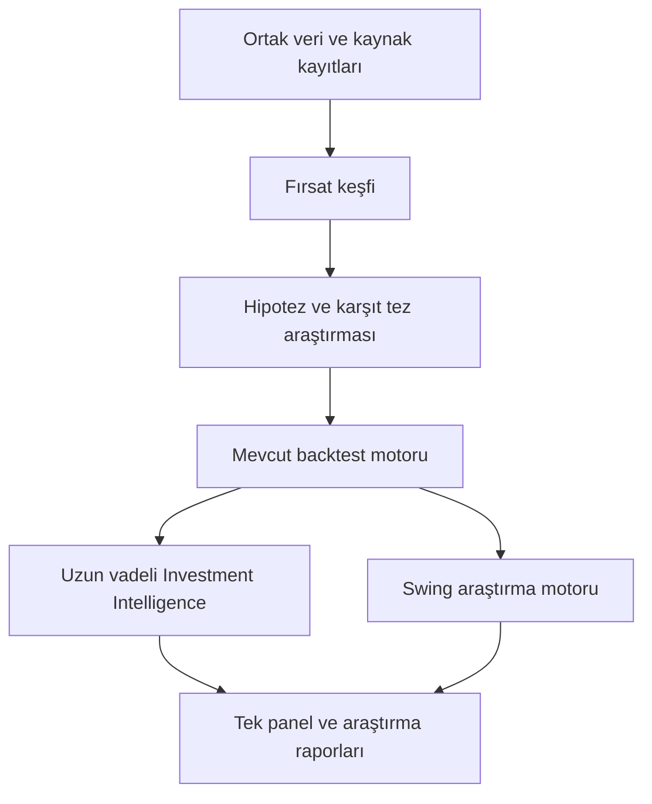

# Crypto Intelligence OS — Konuşma özeti ve Codex proje bağlamı

> Hazırlanma: 9 Ekim 2026. Kaynak: “Cryptonary Ücretsiz Alternatifleri”, konuşma kimliği `6ac87c89-1a44-83eb-89e6-ad29be79291e`.
> Bu belge konuşmanın LinkedIn paylaşımını ve o paylaşımın hazırlanmasına ilişkin içeriği dışarıda bırakır. Uygulama tamamlandı belgesi veya canlı işlem yetkisi değildir.
> Konuşma, ChatGPT ekranından ilk sorudan son göreve kadar okunmuştur. Önizleme ve sohbet okuma aracı yanıt metinleri yerine referans işaretleri döndürdüğü için asıl metin kullanılmıştır.

## 1. Amaç ve statülerin anlamı

Kullanıcı, pahalı bir kripto araştırma üyeliğinin temel kullanım alanlarını ücretsiz veya düşük maliyetli kaynaklarla tek panelde birleştirmek istiyor. Terminal hem uzun vadeli proje araştırması hem swing işlem araştırması yapmalı; sürekli belirsiz ve nötr metinler üretmemeli, kanıtlanmamış kesinlik de sunmamalı. Mevcut backtest motoru korunarak yeni veri ve hipotezler onunla sınanmalı.

Belgedeki statüler:

- **Kesin kullanıcı talebi/beyanı:** Kullanıcının doğrudan söylediği hedef, tercih veya mevcut durum. Teknik olarak bağımsız doğrulanmış olduğu anlamına gelmez.
- **Konuşmadaki öneri:** Önceki asistanın tasarımı veya değerlendirmesi; kullanıcı onayı ve ölçülmüş başarı yerine geçmez.
- **Varsayım/hipotez:** Denenecek fikir, eşik, ağırlık, evren veya maliyet hedefi.
- **Güncel doğrulama gerekli:** Platform şartı, ücret, kota, kapsam veya mevzuat. Konuşmada söylenen rakamlar güncel gerçek olarak uygulanmamalı.

Bu çalışma tarihsel konuşma özetidir. Sağlayıcıların şartları bu oturumda ayrıca doğrulanmamıştır. Aşağıda verilen sayılar konuşmaya atfedilir; uygulama öncesi resmî kaynaktan tarihli teyit gerekir.

## 2. Kesinleşen kullanıcı talepleri ve kullanıcı beyanları

1. Kullanıcı Cryptonary'nin kendisine görünen yaklaşık 100 USD/ay maliyetini yüksek buluyor; temel özelliklerin ücretsiz araçlarla tek panelde toplanmasını istedi.
2. **İki ayrı karar motoru** istedi: uzun vadeli coin araştırması ve swing trading sinyalleri. AI sürekli nötr kalmamalı, doğrulanmamış kesinlik üretmemeli.
3. Kullanıcının mevcut bir backtest motoru var. Slippage, işlem ücreti ve diğer maliyetleri içerdiğini, kendi değerlendirmesine göre vectorbt'den daha ayrıntılı olduğunu söyledi. Bu karşılaştırma ölçülmüş teknik sonuç olarak kabul edilmemeli.
4. Motor çoğunlukla Forex ve hisse piyasalarında denendi. Kriptoda yalnız BTC, ETH ve SOL üzerinde birkaç deneme yapıldı. “Tüm kripto stratejileri denendi” sonucu çıkarılamaz.
5. Denenen birçok strateji maliyetlerden sonra nötr/anlamlı avantaj göstermeyen sonuçlar verdi. EMA, VWAP, RSI ve Stochastic gibi göstergelerin aynı geçmiş fiyat/hacim bilgisini farklı biçimlerde kullandığı kullanıcı tarafından vurgulandı.
6. Kullanıcı, mevcut motor üzerine yeni araştırma katmanı kurmayı veya sistemleri birleştirmeyi daha mantıklı buldu.
7. Hesap türü sonradan netleştirildi: **Maven 5K Pay After Pass**. Önceki genel Maven hesap tabloları bu hesaba doğrudan uygulanamaz.
8. ABD penny stock araştırmasını Midas üzerinden yürütme olasılığını sordu. Bu, ABD piyasasına kesin geçiş kararı değildir.
9. Kriptoyu seçerse Hyperliquid kullanacağını söyledi ve kaldıraç olup olmadığını sordu. Bu, kaldıraç oranı veya canlı işlem onayı değildir.
10. Veri kalitesi, ücretsiz sağlayıcı sayısı, güvenilirlik, işlem riskleri ve spekülasyon ihtimali bakımından alternatiflerin karşılaştırılmasını istedi.

**Henüz kesinleşmedi:** İlk piyasa, penny stock fiyat evreni, hosting seçimi, veri bütçesi, LLM, teknoloji yığını, yeni risk oranı ve canlıya geçiş kriterlerinin sayısal eşikleri. Etkileşimli taslaklarda seçili görünen seçenekler tek başına kullanıcı kararı sayılmamalı.

## 3. Cryptonary ve ücretsiz alternatif yaklaşımı

Konuşmada Cryptonary bir borsa veya kazanç garantili bot yerine araştırma, piyasa analizi, eğitim ve yatırım fikirleri platformu olarak anlatıldı.

| Özellik | Bağımsız alternatif yaklaşımı | Sınır |
|---|---|---|
| Crypto Picks / Trade Ideas | Aday tarama, kurallı sıralama, test edilmiş hipotezler | Analistlerin özel seçimlerinin aynısı değildir |
| Research Reports / AI Intel | Kaynaklı proje araştırması ve karşıt tez | Model metni tek başına kanıt değildir |
| Market Intel / Pulse | Piyasa verileri, haber ve makro olay özeti | Kapsam ve veri gecikmesi ölçülmeli |
| CPT Index | Açıklanabilir kendi 0–100 skoru | Özel algoritma bilinmiyor; birebir kopyalanamaz |
| Portfolio Tracker | CSV veya salt okunur erişimle portföy takibi | Emir/çekim yetkisi gerekmez |
| ETF Flow Tracker | Farside gibi kaynakların akış verisi | Web erişimi otomatik API lisansı değildir |
| Community / eğitim | Açık topluluklar, rehberler ve araştırma arşivi | Özel topluluğun eşdeğeri garanti edilemez |

Başlangıç alternatifleri DefiLlama, Arkham, CoinGlass, Dune ve CoinMarketCap idi. Amaç 15 siteyi yan yana koymaktan öte veriyi toplamak, filtrelemek, adayları sıralamak, gerekçe ve riskleri tek yerde göstermek.

Konuşmadaki fiyat bilgisi: Cryptonary için yıllık ödeme seçeneğinde aylık eşdeğer **66,58 USD**, 7 günlük deneme iddiası aktarıldı. Kullanıcının öğrenci reklamı yüklenemediği için 100 USD teklifinin koşulları doğrulanamadı. Aylık ücretle yıllık ödeme eşdeğeri karıştırılmamalı. Önceki asistan ücretsiz süreci 2–3 hafta denemeyi önerdi; satın alma kararı oluşmadı.

## 4. Mimari: iki karar motoru, üç araştırma katmanı

İki motor farklı zaman ufuklarını temsil eder. Üç katman ise fırsatın keşiften teste geçişini temsil eder; birbirinin alternatifi değildir.

**Discovery Engine:** Hangi varlık araştırmaya değer? On-chain büyüme, funding, OI, unlock, haber, likidite ve değerleme ile aday bulur.

**Hypothesis & Research Engine:** Fırsatın ekonomik/davranışsal mekanizması nedir? Kaynak, karşıt tez, olay analizi, geçmiş örnekler ve test edilebilir kurallar çıkarır.

**Mevcut Backtest Engine:** Hipotez maliyetlerden sonra avantaj sağlıyor mu? Ayrı test dönemi, walk-forward, drawdown ve paper ölçüm yapar.

Başlangıçta konuşma üç teknik swing stratejisini sıfırdan kurmayı önerdi. Kullanıcı mevcut motorunu açıkladıktan sonra öneri değişti: motoru yeniden yazmak yerine farklı bilgi kaynaklarıyla genişletmek. Sonraki Codex bu son yön değişimini esas almalı.

### 4.1 Motor A — Investment Intelligence

Haftalar, aylar ve yıllar için proje araştırması. Proje kalitesi, değerleme ve giriş zamanlaması ayrı sonuçlar olmalı; kaliteli proje ucuz token demek değildir. Protokol büyümesi token sahibine değer aktarımıyla aynı şey değildir.

Konuşmadaki **örnek**, henüz doğrulanmamış ağırlıklar:

| Bileşen | Ağırlık | İncelenen alan |
|---|---:|---|
| Proje büyümesi | %25 | TVL, gelir, kullanıcı, işlem hacmi |
| Tokenomics | %20 | Arz, unlock, enflasyon, token değer yakalama |
| Değerleme | %20 | FDV, gelir çarpanları, benzer projeler |
| Likidite ve piyasa yapısı | %15 | Hacim, spread, derinlik |
| Momentum ve katalizör | %10 | Trend, lansman, güncelleme |
| Güvenlik ve yönetişim | %10 | Denetim, yetkiler, geçmiş olaylar |

Örnek sınıflar: 85–100 HIGH CONVICTION; 70–84 ACCUMULATE CANDIDATE; 50–69 WATCHLIST; 30–49 WEAK; 0–29 AVOID. Üst düzey özet ACCUMULATE / WATCH / AVOID idi. İsimler ve eşikler nihai uygulama sözleşmesi değildir. **85 puan %85 kazanma olasılığı değildir.**

Güvenlik, unlock, likidite veya veri yetersizliği veto oluşturabilir. Eksik veriye sessizce nötr puan verilmemeli; kapsam ve eksik alan görünmeli.

### 4.2 Motor B — Swing araştırma motoru

Önerilen zaman dilimleri 4H ve 1D. İlk teknik adaylar Trend Pullback, Breakout + Retest ve Mean Reversion idi. Her birinin performansı ayrı tutulmalı; bunlar bu projede kanıtlanmış veya LIVE yetkili stratejiler değildir.

Konuşmada LONG / SHORT / WAIT / NO TRADE ve önceki bir taslakta STRONG LONG / STRONG SHORT sınıfları geçti. Uygulama öncesi tek bir çıktı sözleşmesi seçilmeli. Giriş, stop, hedef, geçersizlik koşulu ve büyüklük hesapları kurallı motordan gelmeli; AI bunları değiştirmemeli. LLM kapalıyken sayısal motor çalışabilmeli.

“Nötr kalmama” çözümü:

- Araştırma yönü ile işlem uygunluğu ayrı alanlar olur; olumlu görünüm uygun giriş bulunmadığında WAIT olabilir.
- En güçlü beş long/short araştırma adayı ve beş yatırım adayı gösterme fikri önerildi; listede yer almak işlem yetkisi değildir.
- İşlem çıkmamasının nedeni açık olur: eksik teyit, likidite, maliyet, risk/ödül, veri veya veto.
- Sırf işlem üretmek için eşik düşürülmez; sıfır işlem geçerli bir sonuç olabilir.
- Skorlar, fiyatlar ve kararlar kodla hesaplanır. AI kaynakların tarihini, çelişkileri ve olumlu/olumsuz senaryoları açıklar.

Önerilen kayıt alanları: sembol, piyasa/venue, zaman dilimi, veri zamanı, araştırma yönü, karar, strateji, giriş/stop/hedef veya null, eksik koşullar, veto, model sürümü, `backtest_validated`, kaynaklar. Konuşmadaki BTC fiyatları ve skorları yalnız demo idi; canlı sinyal veya gerçek performans değildir.

## 5. Panel, teknoloji ve otomasyon önerileri

Sekiz modül: Market Pulse, Coin Screener, AI Research, Derivatives, Portfolio, News Intel, Smart Alerts ve Academy. Ortak watchlist, varlık detayları, skor geçmişi, raporlar ve mobil arayüz önerildi.

Önerilen yığın: Next.js + Tailwind + Lightweight Charts arayüz; FastAPI/Python veri ve hesaplama servisi; PostgreSQL tarihsel veri, skor, rapor, portföy ve sonuç kayıtları; n8n zamanlama ve veri akışı; Ollama veya kotası uygun LLM araştırma katmanı. **Bunlar kurulmuş sistem veya kesin teknoloji kararı değildir.** Mevcut motorun dili ve arayüzü önce incelenmeli.

n8n tüm backend yerine otomasyon katmanı olarak önerildi:

1. Market Collector: 15 dakikada fiyat/hacim/temel veri, cache ve kota yönetimi.
2. Opportunity Scanner: Saatlik tarama, sıralama, mükerrer uyarıları önleme.
3. AI News Intelligence: RSS/resmî duyuru, tekrar temizleme, varlık eşleştirme.
4. Deep Research: İstek üzerine tokenomics, büyüme, rekabet, risk ve katalizör raporu.
5. Daily Brief: Sabah piyasa verileri, watchlist değişimi, kaynaklı haber ve risk özeti.

Süreler kullanıcı tarafından kesinleştirilmedi. Bu özet için n8n üzerinde işlem yapılmadı. İleride n8n çalışması yalnız kurulu `mcp__n8n__*` araçlarıyla yapılmalı; doğrudan REST kullanılmamalı. Template ve node keşfi/doğrulama sonrası workflow doğrulama ve test gerekir.

Market Score ile Coin Opportunity Score ayrılmalı. Piyasa skoru demo ağırlıkları: trend/momentum 25, hacim/likidite 20, on-chain 20, türev risk 15, piyasa genişliği 10, makro 10. Bunlar test edilmemiştir; yüksek skor otomatik alım değildir.

## 6. Veri ve API planı: erişim ile test edilebilirliği ayır

| Kaynak | Konuşmadaki kullanım | Uygulama öncesi kontrol |
|---|---|---|
| CoinGecko Demo | Coin evreni, fiyat, piyasa değeri; 10.000 kredi/ay ve 100 istek/dk iddiası | Güncel kota, tarihsel kapsam, lisans, batch/cache |
| DefiLlama | TVL, gelir, zincir/protokol büyümesi; 31 ücretsiz endpoint iddiası | Endpoint bazında ücretsiz/Pro ayrımı; kullanıcı/unlock kapsamı |
| Binance public/Futures | OHLCV, funding, OI, derinlik | Endpoint limitleri, geçmiş veri uzunluğu; OI için son bir ay iddiası |
| Hyperliquid | Kendi piyasasının fiyat, funding, OI ve order book verisi | API kapsamı, retention, limit, sözleşme ve zaman damgası |
| CoinGlass | Web üzerinden türev araştırması | Ücretsiz grafik ≠ ücretsiz API; 29 USD/ay Hobbyist iddiasını teyit et |
| Arkham | Cüzdan/whale araştırması | Ücretsiz arayüz ≠ API erişimi; etiket güvenilirliği |
| Dune | On-chain paneller ve sorgular | API, export, geçmiş kapsam ve kota |
| CoinMarketCap | Watchlist, portföy, temel karşılaştırma | Web/API ve ticari kullanım ayrımı |
| Farside | ETF giriş/çıkışları | Otomasyon izni, gecikme, API olup olmadığı |
| RSS / resmî duyurular | Haber, makro ve olay zamanları | Yayın/ilk erişim zamanı, düzeltme, kaynak ve telif |
| SEC EDGAR | 10-K, 10-Q, 8-K; finansal ve kurumsal açıklamalar | Kimlik bildiren erişim, fair access; 10 istek/sn iddiası |
| Alpaca | ABD hisse fiyat ve tarihsel veri | Ücretsiz IEX akışı iddiası; birleşik SIP kapsamı, OTC, hacim yanlılığı |
| Alpha Vantage | ABD fiyat/temel veri | 25 istek/gün iddiası; endpoint ve gecikme sınırları |
| Finviz / TradingView Screener / Nasdaq | Manuel tarama ve şirket verisi | Ücretsiz ekran ≠ otomatik API veya yeniden dağıtım izni |

Bir borsanın funding/OI verisi tüm piyasanın toplamı değildir. Finansal araştırmanın ücretsiz olması kaliteli tüm-piyasa canlı akışı ve uzun geçmişin ücretsiz olduğu anlamına gelmez. Kaynak sayısından çok doğrulanabilirlik, kapsam, zaman damgası ve point-in-time erişim önemlidir. Eksik tarihsel veri varsa önce forward veri arşivi gerekir.

## 7. Backtest: korunacak altyapı ve araştırma hipotezleri

Yeni sistemin farkı daha fazla indikatörü birleştirmek değil, farklı bilgi türlerinden test edilebilir mekanizmalar üretmek olmalı. Daha çok veri veya AI tek başına avantaj garantisi değildir. Sınırlı BTC/ETH/SOL testlerinden kriptoda edge olmadığı sonucu çıkmaz.

Konuşmada önerilen hipotezler:

| Hipotez | Mekanizma adayı | Veri |
|---|---|---|
| Funding aşırılığı | Kalabalık kaldıraçlı pozisyonların çözülmesi | Funding + OI |
| OI artışı + fiyat sıkışması | Kaldıraç birikimi sonrası hareket | OI + volatilite |
| Unlock öncesi/sonrası | Arz beklentisi ve gerçekleşen satış | Tarihli unlock kayıtları |
| Protokol gelir büyümesi | Temel büyümenin gecikmeli fiyatlanması | Gelir, değerleme, token değer aktarımı |
| BTC liderliği / altcoin rotasyonu | Sermaye rotasyonu | Dominance + göreli güç |

İlk araştırma önerisi funding/OI ile protokol büyümesi/değerleme idi. Örnek soru: 30 günde geliri %40 büyüyen, FDV/geliri benzerlerinden düşük ve 60 günde büyük unlock olmayan projeler sonraki 90 günde BTC'yi geçiyor mu? **%40/60/90 değerleri test edilmemiş hipotezdir.**

Mevcut motorla karşılaştırma önerisi, aynı dönem ve evrende:

- A: Mevcut teknik strateji.
- B: Aynı strateji + funding/OI filtresi.
- C: Aynı strateji + AI destekli aday seçimi.
- D: Fundamental/event-driven yaklaşım.

Amaç AI'nın yalnız rapor kalitesini mi artırdığı, ölçülebilir ek performans mı sağladığını ayırmak.

Ölçümler: net getiri, win rate, profit factor, net expectancy, maksimum drawdown, işlem sayısı/sıklığı ve test dışı performans. Yatırım motoru için 30/90/180 günlük BTC/piyasa karşılaştırması; swing için işlem bazlı sonuç, walk-forward ve paper doğrulama önerildi.

Hata kaynakları: bugünün finansalıyla geçmiş işlem yapmak; yayın tarihini atlamak; sonradan hayatta kalan varlıkları seçmek; düşük likiditeyi ideal dolumla modellemek; borsalar arası ürün farkını yok saymak; sonucu gördükten sonra filtre eklemek. Komisyon, spread, slippage ve ürüne özgü funding/taşıma maliyetleri eklenmeli. Negatif sonuç saklanmamalı; aynı test döneminde tekrar tekrar ayarlama kanıt sayılmamalı.

## 8. Maven 5K Pay After Pass

**Kullanıcının netleştirdiği hesap budur.** Genel 1-Step/2-Step/3-Step/Instant tabloları Pay After Pass hesabının kuralları değildir.

Konuşmanın önceki yanıtında genel Maven listesi BTCUSD, BTCEUR, ETHUSD ve ETHBTC olarak aktarıldı. SOL/XRP/DOGE veya tüm altcoinlerin bulunduğu varsayılmadı. Hesap platformunda hangi sembollerin gerçekten açık olduğu teyit edilmedi.

Tarihsel yanıtın genel hesap tablosu, yalnız kaydı korumak için:

| Genel hesap türü | Aktarılan günlük kayıp | Aktarılan maksimum kayıp |
|---|---|---|
| 1-Step | %3 / 150 USD | %5 / 250 USD trailing |
| 2-Step | %4 / 200 USD | %8 / 400 USD static |
| 3-Step | %2 / 100 USD | %3 / 150 USD static |
| Instant | %2 / 100 USD | %3 trailing; ayrıca %1 açık zarar |

Bu tablo güncel doğrulanmamıştır ve kullanıcının hesabına uygulanmamalıdır. Önceki trailing örneğinde 5.250 equity sonrası 4.987,50 ihlal seviyesi aktarıldı; bu da Pay After Pass kuralı değildir.

Konuşmada Maven işlemlerinin simülasyon ve koşullu performans ödemesi modeli olduğu anlatıldı; 5K serbestçe kaybedilebilir nakit bütçesi sayılmamalı. EA yasağı ve bazı yüksek etkili haberlerin iki dakika öncesi/sonrası kısıtı iddiaları geçti. Sonraki yanıt Pay After Pass için güncel resmî koşulları doğrulayamadığını açıkça belirtti.

Kontrol listesi: challenge aşaması, ödeme zamanı, hedef, günlük/toplam kayıp, static/trailing tanımı, equity/balance ölçümü, reset saati, açık zarar, haber, EA/AI/otomasyon, overnight/hafta sonu, kaldıraç, spread/swap, minimum gün, payout ve yasak stratejiler. Hesap dashboard'u ve o hesaba bağlı sözleşme belirleyici olmalı.

Maven BTCUSD/ETHUSD ile Binance BTCUSDT/ETHUSDT perpetual aynı ürün değildir. Fiyat, spread, funding/swap ve dolum farkıyla birindeki avantaj diğerinde varsayılamaz. Maven ayrı Prop Trading Lab, altcoin tarafı ayrı Opportunity Lab olarak önerildi. Altcoin laboratuvarında önce paper portföy; pennycoin kaldıraçsız araştırma önerildi. Kullanıcı yeni kaldıraç veya risk oranı kararı vermedi.

## 9. ABD penny stock / small-cap ve Midas uyarlaması

Kripto tokenomics/on-chain yerine şirket finansalları, SEC açıklamaları ve hisse arzı kullanılacak. Önerilen yapı: fiyat/hacim evreni → Fundamental Engine → Catalyst Engine → kaynaklı araştırma ve risk sınıflandırması → backtest → manuel değerlendirme.

Fundamental alanları: gelir büyümesi, nakit, borç, nakit tüketimi, finansman ihtiyacı, dilution, ATM programları ve değerleme. Katalizörler: FDA kararı/klinik sonuç, yeni sözleşme, bilanço, haber sonrası fiyatlama, short interest/float/hacim koşulları. Short squeeze ve haber etkisi kanıtlanmış strateji değildir.

Önemli risk: iyi haberle yükselen ama nakdi tükenen şirket yeni hisse ihraç ederek mevcut hissedarı sulandırabilir. Şirket kalitesi, katalizör ve dilution ayrı gösterilmeli. Konuşmadaki 78/100 ve 84/100 skorları gerçek şirkete ait değildi.

Önceki asistanın ilk sürüm önerisi:

| Araştırma filtresi | Önerilen başlangıç |
|---|---|
| Fiyat | 1–5 USD |
| Borsa | Nasdaq / NYSE |
| Piyasa değeri | 50 milyon–1 milyar USD |
| Ortalama günlük işlem tutarı | En az 2 milyon USD |
| Raporlama | Güncel SEC dosyaları |
| İşlem uygunluğu | Midas'ta bulunmalı |

Aşırı spread, yaklaşan delisting, tekrarlayan reverse split, yoğun dilution ve açıklanamayan hacim patlamaları ek eleme adayı. Bunlar kârlılık veya güvenlik garantisi değildir. 0,10–1 USD aşırı spekülatif/özellikle OTC hisseler sonradan ayrı yüksek risk modülü olarak önerildi. Kullanıcı bu evreni henüz seçmedi. Hisse fiyatı tek başına şirket kalitesi değildir.

### Midas'a ilişkin konuşma iddiaları

- Nasdaq/NYSE ve seçili OTC erişimi olduğu aktarıldı; tüm penny stockların mevcut olduğu varsayılamaz.
- ABD işlemi için 1,50 USD tek yön ücret ve fiyatı 1 USD altında 300 adedi aşan her ek hisseye 0,005 USD iddiası aktarıldı. Güncel tarife teyit edilmeli.
- Bu modelle 500 USD pozisyonun gidiş-dönüş komisyon örnekleri: 2 USD hissede 250 adet → 3 USD/%0,6; 0,50 USD hissede 1.000 adet → 10 USD/%2; 0,20 USD hissede 2.500 adet → 25 USD/%5. Aynı miktar ve fiyat varsayımı, spread/slippage/vergi/diğer ücretler hariç.
- TradingView emir entegrasyonu olduğu söylendi; kişisel geliştiricilere açık resmî emir API'si doğrulanamadı. Araştırma terminali ve uyarı, ardından kullanıcının manuel emri önerildi.
- Stop tetiklenince limit emrine dönüşebildiği iddiası geçti; gap/halt durumunda dolum garanti edilemez. Güncel emir türü ve koşullar teyit edilmeli.
- ABD hisse satış kazançları için Türkiye'de beyan gerekliliği aktarıldı. Tutar eşiği, hesaplama, kur, temettü ve güncel mevzuat ayrıca doğrulanmalı; bu özet vergi talimatı değildir.

## 10. Hyperliquid

Konuşmada spot ve perpetual, long/short, cross/isolated margin, saatlik funding ve resmî veri/emir API'si anlatıldı. Kaldıraç sorusuna evet yanıtı verildi.

Aktarılan üst sınırlar BTC 40x, ETH 25x, SOL 20x idi. Bunlar konuşmadaki margin tier iddialarıdır; varlık, pozisyon büyüklüğü ve güncel sözleşme metadata'sına göre teyit edilmeli. Platform tavanı önerilen risk oranı değildir. Spot ile kaldıraçlı perpetual birbirine karıştırılmamalı.

Türkiye'den hesap/işlem uygunluğu konuşmada kesin doğrulanamadı. Kullanım koşulları, bölgesel kısıtlar ve mevzuat uygulamadan önce incelenmeli. API entegrasyonunun kolaylığı kârlılığı göstermez. Likidasyon, funding, volatilite, spread ve derinlik birlikte modellenmeli. İleride otomasyon teknik olarak mümkün diye anlatıldı; kullanıcı bunun yapılmasını bu görevde istemedi.

## 11. Alternatiflerin karşılaştırılması ve kararın durumu

| Boyut | 1–5 USD Nasdaq/NYSE şirketleri | 0,10–1 USD spekülatif hisseler | Hyperliquid kripto |
|---|---|---|---|
| Temel araştırma | SEC raporlaması güçlü kaynak | Raporlama/kapsam değişken; OTC daha sorunlu olabilir | On-chain/protokol verisi; token değer aktarımı ayrı |
| Ücretsiz canlı veri | Birleşik tüm-piyasa akışı sınırlı | Kapsam ve düşük likidite sorunu | Venue verisi daha erişilebilir olabilir |
| Manipülasyon | Mevcut, şirket bazında incelenmeli | Bilgi azlığı ve düşük likiditeyle artabilir | Altcoin ve derinliğe bağlı |
| İşlem riski | Gap, halt, dilution, spread | Daha ağır dolum ve maliyet riski | Kaldıraçla likidasyon ve funding |
| Otomasyon | Midas resmî emir API'si belirsiz | Aynı belirsizlik ve evren sorunu | API ekosistemi daha doğrudan |
| Mevcut motora uyarlama | Şirket ve olay verisi gerekir | Kaliteli geçmiş/dolum daha zor | Ürün bazlı veriyle görece doğrudan |

Konuşmadaki asistan tercihi: şirket araştırması ve olay analizi için düzenli raporlayan 1–5 USD small-cap şirketleri; ücretsiz canlı veri ve otomasyon öncelikliyse Hyperliquid teknik olarak daha uygun olabilir. **Bu kullanıcı tarafından onaylanmış piyasa seçimi değildir.** Yükseliş potansiyeli, veri erişimi ve para kazanma kolaylığı farklı sorulardır.

## 12. Maliyet, kapsam ve önerilen takvim

0 USD/ay MVP bir hedef/varsayımdır: mevcut bilgisayar, self-host PostgreSQL/n8n ve yerel LLM ile ek abonelik azaltılabilir. Elektrik, donanım, 7/24 hosting, mevcut VPS maliyeti, API kotası ve tarihsel veri giderleri yok sayılmamalı. Tüm borsaların likidasyon haritaları, profesyonel whale ve geçmiş on-chain kapsamı ücretsiz eşdeğer olmayabilir.

İlk öneri 20–30 likit coinle bir skor, kaynaklı rapor ve bildirim; sonraki taslak 20 coinlik swing ve 50–100 projelik yatırım taramasıydı. Bunlar aşamalı evren önerileri, kesin sayı değildir.

Tarihsel 14 günlük plan: gün 1–3 altyapı/veri; 4–6 grafik/tarama/skor; 7–10 AI/otomasyon/Telegram; 11–14 portföy, limit/hata ve mobil kontrol. Mevcut motor açıklandıktan sonra gereksiz yeniden yazım yerine entegrasyon önceliği geldi. Takvim işçilik garantisi veya tamamlanmış iş değildir.

Portföy için CSV/salt okunur erişim, çekim yetkisini kapatma önerildi. SaaS olasılığı yalnız gelecekte bir fikir; ücretsiz kişisel API izni ticari yeniden dağıtım hakkı değildir.

## 13. Mevcut borsa projesiyle sınırlar

Bu belge `C:\Users\quantum\OneDrive\Masaüstü\borsa` projesine eklendi. Yerel `AGENTS.md` mevcut canlı düzeni ayrı tanımlar: SWEEP_CORE tek LIVE yetkili mekanik modül, EMA12 PAPER; kullanıcı emir verir, asistan emir açmaz/kapatmaz/değiştirmez. Mevcut protokolde yön önerisi ve haberden yön tezi üretimi kısıtlıdır.

Konuşmadaki LONG/SHORT, AI yorum ve katalizörden hipotez önerileri **araştırma tasarımının tarihsel kaydıdır**. Bu özet canlı modül ekleme, Telegram sinyali başlatma, mevcut risk/strateji kurallarını değiştirme veya hesabı otomasyona bağlama yetkisi vermez. Araştırma kapsamı ile mevcut seans protokolü uygulama öncesinde açıkça ayrılmalı.

Kod incelemesine başlanmadı; bu görev belge üretimidir. Büyük kod tabanında ileride uygulamaya başlanırsa mevcut `graphify-out/graph.json` kontrol edilmeli, scoped graph sorguları kullanılmalı; yoksa kullanıcı talimatındaki graphify üretim akışı uygulanmalı. Bu görevde kaynak kod, workflow veya defter değiştirilmedi.

## 14. Yapılacak işler ve açık kararlar

### Önce netleştirilecekler

- [ ] İlk MVP piyasası: kripto/Hyperliquid mi, 1–5 USD ABD small-cap mi? İki piyasayı aynı anda başlatmak konuşmada kesinleşmedi.
- [ ] ABD hedefi gerçek faaliyetli small-cap araştırması mı, 0,10–1 USD yüksek spekülasyon mu?
- [ ] Mevcut motorun dili, veri formatı, maliyet/dolum modeli ve entegrasyon arayüzü belirlenmeli.
- [ ] Maven Pay After Pass dashboard/sözleşmesinden güncel kurallar ve açık semboller alınmalı.
- [ ] Hosting, veri/LLM bütçesi, tarama evreni ve sıklığı belirlenmeli.
- [ ] Araştırma çıktılarının mevcut canlı protokolle sınırı netleşmeli.

### Veri ve deney aşaması

- [ ] Her sağlayıcı için kapsam, kota, lisans, gecikme ve tarihsel veri matrisi çıkar.
- [ ] Veri zamanı, yayın zamanı ve ilk erişim zamanını tut; venue/ürün kimliklerini ayır.
- [ ] Eksik veri ve stale veri davranışını açık tanımla; eksikliği nötr puanla gizleme.
- [ ] Tek ön kayıtlı hipotez ailesi seç; ekonomik mekanizma ve çürüten koşul yaz.
- [ ] Mevcut motorla A/B/C/D ek değer ölçümü tasarla; test dışı dönem ve maliyetleri sabitle.
- [ ] İki motorun skor/etiket sözleşmesini ve performans ölçümünü ayır.
- [ ] Backtest sonrası forward/paper ölçüm yap; negatif sonuçları ve elenenleri kaydet.

### Panel ve otomasyon aşaması

- [ ] İlk paneli watchlist, kaynaklı rapor, veri durumu ve test sonucu etrafında dar tut.
- [ ] AI'nın sayısal kararı değiştirmesini engelle; model olmadan hesaplama çalışsın.
- [ ] n8n kurulumu gerekirse MCP ile keşfet, doğrula ve test et; bu belgede workflow kurulmadı.
- [ ] Bildirimlerde tekrar önleme, kaynak/zaman, eksik koşul ve araştırma statüsü göster.
- [ ] Portföyü CSV veya salt okunur erişimle ekle; canlı emir yetkisini ayrı tut.

Başarı: anlaşılır ve kaynaklı çıktının yanında, yeni veri/aday seçiminin mevcut motora göre maliyet sonrası ve test dışı ölçülebilir katkısı gösterilmeli. Sürekli kesin konuşmak, çok sinyal üretmek veya güzel skor kartları tek başına başarı değildir.

## 15. Kaynak izleri ve resmî kontrol başlangıçları

- [Kaynak ChatGPT konuşması](https://chatgpt.com/c/6ac87c89-1a44-83eb-89e6-ad29be79291e)
- [Cryptonary](https://cryptonary.com/)
- [CoinGecko API](https://www.coingecko.com/en/api) · [DefiLlama API](https://api-docs.defillama.com/)
- [Binance türev dokümanları](https://developers.binance.com/docs/derivatives/Introduction)
- [Hyperliquid dokümanları](https://hyperliquid.gitbook.io/hyperliquid-docs)
- [CoinGlass API](https://www.coinglass.com/pricing) · [Arkham](https://intel.arkm.com/) · [Dune](https://dune.com/)
- [SEC EDGAR API](https://www.sec.gov/search-filings/edgar-application-programming-interfaces) · [SEC EDGAR arama](https://www.sec.gov/edgar/search/)
- [Alpaca Market Data](https://docs.alpaca.markets/docs/about-market-data-api) · [Alpha Vantage](https://www.alphavantage.co/)
- [Finviz](https://finviz.com/screener.ashx) · [TradingView Screener](https://www.tradingview.com/stock-screener/)
- [Midas](https://www.getmidas.com/) · [Maven Trading](https://maventrading.com/)

Bu bağlantılar doğrulama başlangıcıdır; bu belge bağlantılardaki güncel koşulların yeniden denetlendiğini iddia etmez. Sağlayıcı seçimi veya hesap kuralı uygulanırken resmî sayfa/sözleşme, kontrol tarihi ve ilgili ürün kaydı eklenmeli.
